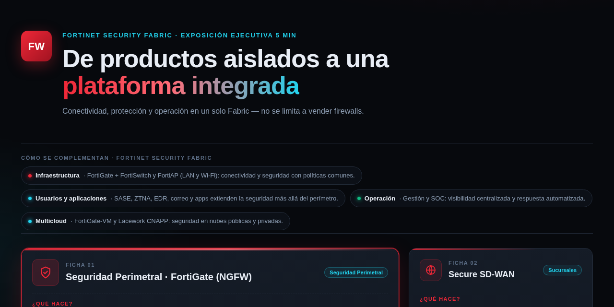
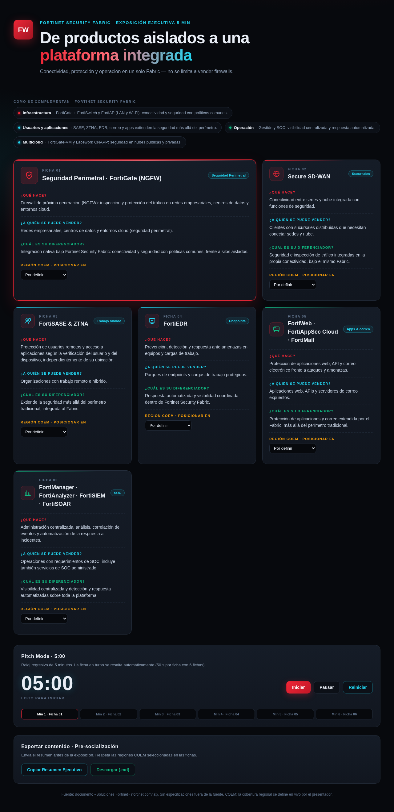

<div align="center">



# FORTISELL SUITE
### Habilitador comercial · Fortinet Security Fabric · COEM

**Doce líneas de solución para vender en 5 minutos — con temporizador guiado, cobertura COEM editable y exportación pre-socialización. Un solo `index.html`.**

<br/>


</div>

> Estilo **reporte corporativo tradicional**: serif en títulos, paleta navy/granate sobre blanco, sin neones. La versión anterior (dark neón) sigue disponible en [`version-neon.html`](version-neon.html).

---

## 🗂️ Portafolio: 12 líneas de solución

| # | Línea | Qué resuelve | Fuente |
|:-:|:--------|:--------------------------------|:----:|
| 01 | **FortiGate — NGFW** ★ insignia | Inspección y protección de tráfico en red, DC y cloud (línea insignia del Fabric) | doc |
| 02 | **Secure SD-WAN** | Conectividad entre sedes y nube, integrada con funciones de seguridad | doc |
| 03 | **SD-Branch** | Sucursal completa definida por software: NGFW + switching + Wi-Fi en una sola solución | [P] |
| 04 | **FortiSASE & ZTNA** | Acceso a aplicaciones condicionado a la verificación de usuario y dispositivo | doc |
| 05 | **FortiAuthenticator & FortiPAM** | Identidad y accesos privilegiados con control de sesiones | [P] |
| 06 | **FortiEDR** | Prevención, detección y respuesta en equipos y cargas de trabajo | doc |
| 07 | **FortiWeb · FortiAppSec Cloud · FortiMail** | WAF, seguridad de API y protección del correo electrónico | doc |
| 08 | **FortiSandbox** | Detección de amenazas de día cero en un sandbox automatizado | [P] |
| 09 | **FortiNDR & FortiDLP** | Visibilidad de la red contra amenazas avanzadas y prevención de pérdida de datos | [P] |
| 10 | **FortiGate-VM & Lacework FortiCNAPP** | Seguridad consistente en nubes públicas, privadas y cloud-native | doc |
| 11 | **FortiAI · FortiLLM** | Seguridad y gobernanza para entornos de IA generativa, la pregunta #1 de los clientes en 2026 | [P] |
| 12 | **FortiManager · FortiAnalyzer · FortiSIEM · FortiSOAR** | Operaciones de SOC centralizadas y automatización de la respuesta | doc |

**Doble fuente, doble trazabilidad:** cada línea lleva etiqueta de su origen — texto del documento base (sin etiquetar) o portafolio público de Fortinet `[P]`. La exportación .md conserva las etiquetas. **Ningún dato se inventa: ni cifras, ni precios, ni cobertura.**

---

## ⚡ Funciones de la aplicación

### ⏱ Modo Pitch
Reloj regresivo con **duración configurable** (5 / 10 / 12 min). La línea que toca se ilumina en rojo y las 12 fichas se reparten el tiempo automáticamente — con 5 min, ~25 s por línea.

### 🌎 Cobertura COEM editable
Cada ficha tiene su selector de región (Central · Andina · Norte · Sur · nacional). Estado inicial: **"Por definir"** — es el presentador quien asigna, no la herramienta.

### 📤 Exportación
- **Copiar resumen ejecutivo** → texto plano para pegarlo en el correo de pre-socialización
- **Descargar .md** → documento con las regiones elegidas y las etiquetas de fuente
- **Imprimir / PDF** → hoja de estilo de reporte: sin temporizador, sin controles

### 🎨 Reporte corporativo
Fondos claros, serif (Georgia) en títulos, acento granate `c8102e`, una línea por ficha. Se lee igual en sala de juntas, laptop o tableta.



---

## 🚀 Publicación en GitHub Pages

```text
Settings → Pages → Build and deployment → Source: Deploy from a branch
Branch: main (o master, según tu repositorio) / Root directory → Save
```

La página sirve **solo estáticos**: el `index.html` abre con doble clic, sin servidor ni dependencias. Las rutas del nav (`Soluciones · Modo Pitch · Exportar`) son anclas internas.

---

## 🧾 Fuente y descargo

Construido sobre el documento «Soluciones Fortinet» (fortinet.com/lat) y el portafolio público de Fortinet. Las líneas `[P]` añaden servicios que los clientes ya están pidiendo (SD-Branch, NDR/DLP, IA segura, anti-APT, identidad privilegiada) con descripciones funcionales de alto nivel.

**No es marketing oficial de Fortinet.** El portafolio se describe a nivel funcional: especificaciones, precios y disponibilidad se confirman con el representante de cuentas.

---

<div align="center">

*Un solo archivo, doce líneas en discusión y ninguna respuesta improvisada.*

</div>

